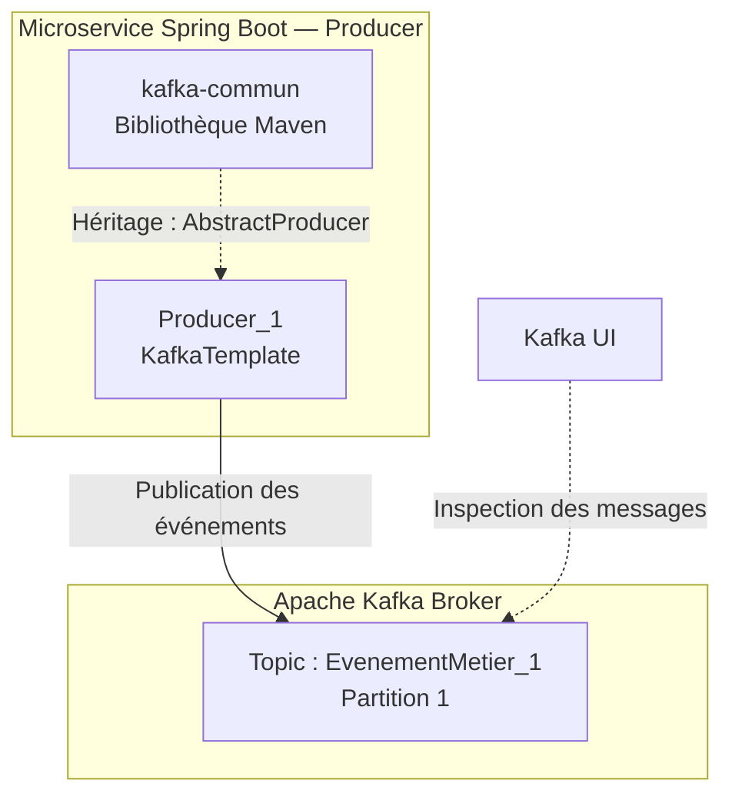

# Scénario 01 — Producer → Broker (sans Consumer)

## 1. Objectif

**Hypothèse :** un Producer Kafka peut publier des événements dans un topic même lorsqu'aucun Consumer n'est actif.

**Objectif de l'expérience :**

>Mettre en place une communication entre un microservice Producer Spring Boot et un broker Apache Kafka, sans Consumer, afin de comprendre le mécanisme de publication des événements, leur stockage dans les partitions d’un topic et leur persistance indépendamment de leur consommation.

## 2. Architecture

### Composants

- **Producer :** microservice Spring Boot.
- **Kafka Broker :** réception et stockage des événements.
- **Kafka UI :** inspection des topics et des messages.
- **kafka-commun :** bibliothèque partagée.

### Schéma

## 3. Implémentation / Procédure

### Configuration de l'environnement

*À compléter.*

### Configuration du topic

*À compléter.*

### Implémentation du Producer

*À compléter.*

### Exécution

*À compléter.*

## 4. Expérimentations

### Expérience 1 — Création du topic

**Procédure :**

**Résultat attendu :**

**Résultat observé :**

### Expérience 2 — Publication sans Consumer

**Procédure :**

**Résultat attendu :**

**Résultat observé :**

## 5. Test de panne — Broker indisponible

**Hypothèse :** avec `fail-fast=true`, le démarrage du microservice doit échouer si Kafka est inaccessible.

**Configuration :**

*À compléter.*

**Procédure :**

*À compléter.*

**Résultat attendu :**

*À compléter.*

**Résultat observé :**

*À compléter.*

## 6. Résultats et observations

| Expérience | Résultat attendu | Résultat observé |
|---|---|---|
| Création du topic | | |
| Publication sans Consumer | | |
| Broker indisponible | | |

### Difficultés rencontrées

*À compléter.*

### Enseignements techniques

*À compléter.*

## 7. Conclusion

**Hypothèse validée ou invalidée :**

*À compléter.*

**Ce que démontre le scénario :**

*À compléter.*

**Limites de l'expérience :**

*À compléter.*