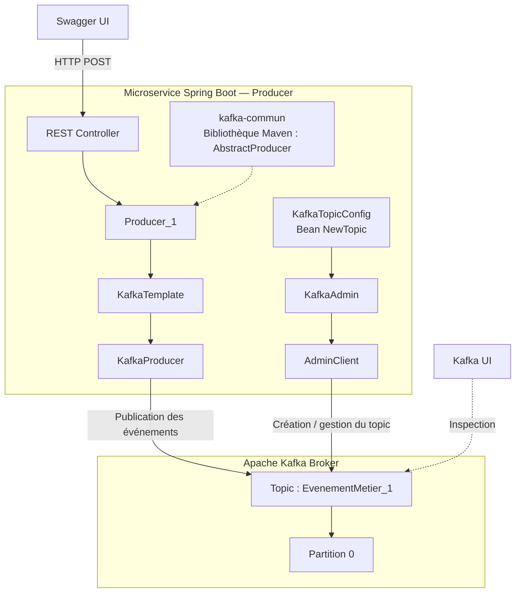

# Scénario 01 — Producer → Broker (sans Consumer)

## Objectif

Étudier le fonctionnement de la publication d'événements dans Apache Kafka à partir d'un microservice Spring Boot, sans Consumer actif.

Ce scénario permet de comprendre :

- Le rôle du Producer, du broker, des topics et des partitions.
- La publication asynchrone avec `KafkaTemplate` et `CompletableFuture`.
- La création explicite des topics avec `KafkaAdmin` et `NewTopic`.
- La persistance des événements indépendamment de leur consommation.
- La gestion des erreurs de connexion, des retries et des timeouts.

## Hypothèse

Un microservice Producer peut publier des événements dans un topic Kafka même lorsqu'aucun Consumer n'est actif.

Les événements doivent être stockés dans les partitions du topic et rester consultables dans Kafka UI selon la politique de rétention configurée.

La publication doit être confirmée par le broker et retourner les métadonnées du message : topic, partition et offset.

En cas d'indisponibilité du broker au démarrage, la configuration `fail-fast=true` doit provoquer l'échec de l'initialisation administrative après expiration des délais configurés.

## Prérequis

### Infrastructure

- Un broker Apache Kafka exécuté dans Docker, en mode KRaft.
- Kafka UI pour inspecter les topics et les messages.
- Un microservice Spring Boot `producer`.
- Une bibliothèque Java Maven `kafka-commun`.

Aucun Consumer n'est nécessaire.

### Environnement technique

| Technologie | Version / configuration |
|---|---|
| Java | 21 |
| Spring Boot | 4.1.1 |
| Apache Kafka Client | 4.2.1 (version observée dans les logs) |
| Maven | Gestion des dépendances et compilation |
| Docker Compose | Exécution de l'infrastructure Kafka |
| Springdoc OpenAPI | 3.1.0 |
| Broker Kafka | `localhost:6000` depuis le Producer |
| API REST | Port `8081` lors des tests |

### Architecture



`kafka-commun` est une bibliothèque partagée, intégrée au microservice Producer par une dépendance Maven. Ce n'est pas un service indépendant.

## Configuration

### 1. Configuration du topic

Le topic est déclaré dans le microservice avec un bean Spring `NewTopic`.

```java
@Configuration
public class KafkaTopicConfig {

    @Bean
    public NewTopic evenementMetierTopic() {
        return new NewTopic(
            "EvenementMetier_1",
            1,
            (short) 1
        );
    }
}
```

- **Partitions :** 1, identifiée par `0`.
- **Facteur de réplication :** 1.
- **Création :** effectuée explicitement par `KafkaAdmin` lors de l'initialisation de Spring Boot.

### 2. Configuration Spring Kafka

Extrait de `application.properties` :

```properties
spring.application.name=producer

spring.kafka.bootstrap-servers=localhost:6000
spring.kafka.admin.fail-fast=true

spring.kafka.producer.key-serializer=org.apache.kafka.common.serialization.StringSerializer
spring.kafka.producer.value-serializer=org.apache.kafka.common.serialization.StringSerializer

server.port=8081

springdoc.swagger-ui.path=/swagger-ui.html
springdoc.api-docs.path=/v3/api-docs

logging.file.name=logs/producer.log
```

Les délais administratifs ont également été expérimentés :

```properties
spring.kafka.admin.properties.retries=3
spring.kafka.admin.properties.request.timeout.ms=3000
spring.kafka.admin.properties.default.api.timeout.ms=5000
```

Ces valeurs constituent une configuration de test. Elles peuvent être adaptées à l'environnement.

### 3. Configuration du broker

La création automatique des topics a été désactivée au niveau du broker :

```properties
auto.create.topics.enable=false
```

Cette propriété empêche la création implicite des topics inconnus, mais autorise toujours leur création explicite via `KafkaAdmin`.

**Remarque :** la syntaxe Docker Compose dépend de l'image Kafka utilisée. La configuration effective du broker doit être vérifiée.

## Procédure

### Expérience 1 — Publication sans Consumer

1. Démarrer le broker Kafka et Kafka UI avec Docker Compose.
2. Démarrer le microservice `producer` avec `mvn spring-boot:run`.
3. Vérifier que `KafkaAdmin` initialise le topic `EvenementMetier_1`.
4. Ouvrir Swagger UI sur `http://localhost:8081/swagger-ui.html`.
5. Envoyer une requête HTTP de publication.
6. Vérifier la réponse HTTP et les logs du Producer.
7. Ouvrir Kafka UI et inspecter le topic, la partition et le message.

Aucun Consumer n'est démarré pendant cette expérience.

### Expérience 2 — Création explicite et création automatique

1. Déclarer un topic `EvenementMetier_1` avec `NewTopic`.
2. Utiliser volontairement un nom différent dans le Producer : `EvennementMetier_1`.
3. Observer le comportement avec la création automatique activée.
4. Désactiver `auto.create.topics.enable` sur le broker.
5. Supprimer les topics de test.
6. Redémarrer le broker et le Producer.
7. Observer les topics créés, puis tenter une publication vers le topic non déclaré.

Cette expérience permet de distinguer la création implicite par le broker de la création explicite par `KafkaAdmin`.

### Expérience 3 — Broker indisponible au démarrage

1. Arrêter le broker Kafka.
2. Conserver `spring.kafka.admin.fail-fast=true`.
3. Démarrer le microservice Producer.
4. Observer les tentatives de connexion, les délais d'attente et l'échec de l'initialisation.
5. Redémarrer Kafka et vérifier le fonctionnement normal du Producer.

### Expérience 4 — Réinitialisation du broker

1. Démarrer le Producer avec Kafka disponible.
2. Réinitialiser les données Kafka et redémarrer le broker, sans redémarrer le Producer.
3. Observer que les topics déclarés par `NewTopic` ne sont pas automatiquement réinitialisés par le microservice déjà actif.
4. Redémarrer le Producer ou déclencher explicitement `KafkaAdmin.initialize()`.
5. Vérifier la recréation du topic.

Cette expérience distingue le cycle de vie du broker de celui du microservice.

## Résultats

### 1. Publication confirmée

Réponse HTTP obtenue depuis Swagger :

```text
HTTP 200 OK

Message envoye avec succes : EvennementMetier_1-0@0
```

Logs métier observés :

```text
06:54:48.606 - Début de publication Kafka
06:54:48.700 - Attendre la response future (join)
06:54:48.832 - Publication confirmée :
               topic=EvenementMetier_1,
               partition=0,
               offset=0
```

La confirmation a été obtenue environ **226 ms** après le premier log de publication.

Le Producer attend la résolution du `CompletableFuture` avec `.join()` avant de retourner sa réponse HTTP.

### 2. Observation dans Kafka UI

| Métadonnée | Valeur observée |
|---|---|
| Topic | `EvennementMetier_1` |
| Partition | `0` |
| Offset | `0`, puis `2` lors d'un test ultérieur |
| Timestamp | `16/10/2026 06:54:48` |
| Timestamp type | `CREATE_TIME` |
| Key Serde | `String` |
| Taille de la clé | 3 octets |
| Value Serde | `String` |
| Taille de la valeur | 21 octets |

Le message est visible dans Kafka UI sans Consumer actif.

### 3. Création des topics

Deux topics ont été observés :

| Topic | Origine identifiée |
|---|---|
| `EvenementMetier_1` | Bean `NewTopic`, initialisé par `KafkaAdmin` |
| `EvennementMetier_1` | Création implicite par le broker lors des premiers tests |

Après désactivation de la création automatique et suppression des topics, une tentative de publication vers le topic non déclaré a produit :

```text
UNKNOWN_TOPIC_OR_PARTITION
```

Ce résultat est cohérent avec un broker qui ne crée plus implicitement le topic demandé.

### 4. Indisponibilité du broker

Avec Kafka arrêté, le client administratif a échoué lors de la récupération des nœuds du cluster :

```text
org.apache.kafka.common.errors.TimeoutException:
Timed out waiting for a node assignment.
Call: listNodes
```

Les expérimentations ont permis de distinguer :

- `retries` : nouvelles tentatives de certaines requêtes Kafka.
- `request.timeout.ms` : délai d'attente d'une requête.
- `default.api.timeout.ms` : délai global d'une opération administrative.
- `reconnect.backoff.ms` : délai initial entre les tentatives de reconnexion.
- `fail-fast` : échec de l'initialisation administrative si Kafka reste inaccessible.


### 5. Validation finale — Publication après correction

Après correction de la configuration Kafka et des problèmes rencontrés lors des expérimentations, un nouveau test de publication a été effectué depuis Swagger UI.

**Résultat attendu :**

- Publication de l'événement dans le broker Kafka.
- Confirmation de publication par le Producer.
- Réponse HTTP `200 OK`.
- Attribution d'une partition et d'un offset au message.
- Visualisation de l'événement dans Kafka UI (à vérifier séparément).

**Résultat observé :**

Réponse HTTP obtenue depuis Swagger UI :

```text
HTTP 200 OK

Message envoye avec succes : EvennementMetier_1-0@0
```

En-têtes de réponse :

```text
connection: keep-alive
content-length: 51
content-type: text/plain;charset=UTF-8
```

Log métier du microservice Producer :

```text
2026-10-16T08:07:40.716+02:00 INFO 2808 --- [producer] [nio-8081-exec-1] lab.producer.service.Producer_1 : Publication confirmée : topic=EvennementMetier_1, partition=0, offset=0
```

| Métadonnée | Valeur |
|---|---|
| Date | 16/10/2026 |
| Heure | 08:07:40 |
| Code HTTP | `200 OK` |
| Topic | `EvennementMetier_1` |
| Partition | `0` |
| Offset | `0` |
| Confirmation Kafka | Réussie |

**Observation :**

Le microservice Producer a publié l'événement avec succès. L'appel à `CompletableFuture.join()` a permis d'attendre la confirmation du broker avant de retourner la réponse HTTP.

Le message a été enregistré dans la partition `0` du topic `EvennementMetier_1`, avec l'offset `0`.

**Conclusion :**

La publication est confirmée après les corrections apportées à l'environnement KafkaLab. Le Producer communique correctement avec le broker et peut publier des événements sans Consumer actif.

Ce test valide le flux **Swagger UI → REST Controller → Producer → Kafka Broker**. La visualisation de ce nouvel événement dans Kafka UI peut être consignée après vérification.

### 6. Synthèse

| Expérience | Résultat |
|---|---|
| Publication sans Consumer | Confirmée |
| Acquittement du broker | Confirmé |
| Consultation via Kafka UI | Confirmée |
| Création explicite avec `KafkaAdmin` | Observée |
| Désactivation de la création implicite | Comportement attendu observé |
| Broker indisponible | `TimeoutException` observée |
| Réinitialisation du broker sans redémarrage du Producer | Topic non recréé automatiquement |


## Conclusion

**Hypothèse principale confirmée.**

Un Producer Spring Boot peut publier des événements dans Kafka sans Consumer actif. Le broker les enregistre dans les partitions du topic, et le Producer reçoit une confirmation contenant les métadonnées de publication.

Les expérimentations ont également montré que :

- Les topics sont des ressources du cluster Kafka, indépendantes des microservices.
- `KafkaAdmin` permet de créer explicitement les topics déclarés par les beans `NewTopic`.
- La désactivation de `auto.create.topics.enable` empêche les créations implicites et facilite la détection des erreurs de nommage.
- Une confirmation de publication ne signifie pas qu'un Consumer a traité l'événement.
- Les paramètres de timeout et de reconnexion permettent de maîtriser le comportement du client lorsque Kafka est indisponible.
- La réinitialisation des topics par `KafkaAdmin` est liée à l'initialisation du contexte Spring, sauf déclenchement explicite ultérieur.

**Limites :** ce scénario utilise un broker unique, une partition et un facteur de réplication de 1. La consommation, la répartition de charge, la réplication et la tolérance aux pannes du cluster seront abordées dans les scénarios suivants.

**Prochaine étape : Scénario 02 — Producer → Consumer.**