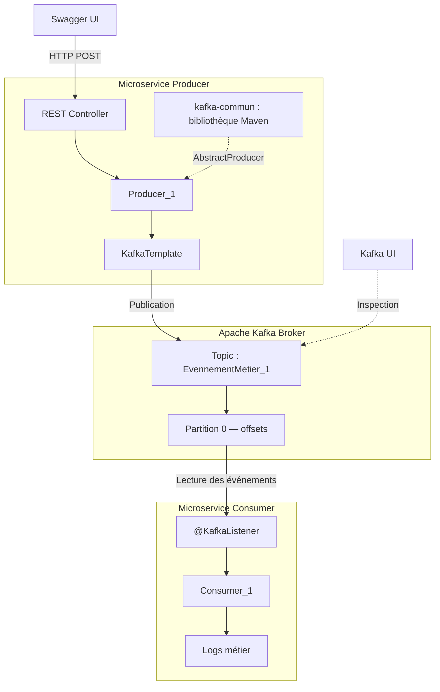

# Scénario 02 — Producer → Consumer

## Objectif

Mettre en place un microservice **Consumer Spring Boot** capable de lire les événements publiés par le microservice **Producer** dans un topic Apache Kafka.

Étudier :

- La différence entre publication et consommation d'événements.
- Le fonctionnement de `@KafkaListener` et des désérialiseurs Kafka.
- L'abonnement à un topic et l'appartenance à un **Consumer Group**.
- La lecture d'événements déjà stockés avec `auto-offset-reset=earliest`.
- L'identification des messages par leur topic, partition, offset, clé et valeur.

## Hypothèse

Un Consumer appartenant à un **nouveau groupe**, configuré avec `auto-offset-reset=earliest`, peut lire les messages encore conservés dans Kafka **même s'ils ont été publiés avant son démarrage**.

Le Producer n'a pas besoin de connaître le Consumer ni son `group.id` : les deux microservices communiquent indirectement par l'intermédiaire du topic Kafka.

## Prérequis

- Un broker **Apache Kafka** en fonctionnement, lancé avec Docker Compose.
- **Kafka UI** pour inspecter le topic et les messages.
- Le microservice Spring Boot **`producer`** du scénario 01.
- Le microservice Spring Boot **`consumer`**, avec Spring Kafka.
- La bibliothèque Maven partagée **`kafka-commun`** pour les composants réutilisables du Producer.
- Un topic partagé entre les deux microservices.

| Élément | Configuration utilisée |
|---|---|
| Java | 21 |
| Spring Boot | 4.1.1 (version du Producer ; à vérifier dans le Consumer) |
| Broker depuis les applications | `localhost:6000` |
| Topic testé | `EvennementMetier_1` |
| Partition observée | `0` |
| Clé des messages | `String` |
| Valeur des messages | `String` |

> **Attention au nom du topic :** les expériences précédentes ont utilisé les deux orthographes `EvenementMetier_1` et `EvennementMetier_1`. Les logs du Consumer fournis pour ce scénario montrent **`EvennementMetier_1`**. Il faut conserver exactement le même nom côté Producer et Consumer, puis harmoniser ce nom dans le code.

### Architecture



## Configuration

### 1. Producer

Le Producer publie des messages dans le topic Kafka à l'aide de `KafkaTemplate<String, String>`.

```java
kafkaTemplate.send("EvennementMetier_1", "123", message);
```

La publication est asynchrone. Dans l'implémentation du scénario 01, l'appel à `.join()` permet d'attendre sa confirmation avant de répondre à l'appel HTTP.

Aucun `group.id` n'est nécessaire côté Producer.

### 2. Consumer — `application.properties`

```properties
spring.application.name=consumer
spring.kafka.bootstrap-servers=localhost:6000

# Consumer Group
spring.kafka.consumer.group-id=kafkalab-group-1

# Pour un groupe sans offset valide : premier message encore disponible
spring.kafka.consumer.auto-offset-reset=earliest

# Deserialisation String
spring.kafka.consumer.key-deserializer=org.apache.kafka.common.serialization.StringDeserializer
spring.kafka.consumer.value-deserializer=org.apache.kafka.common.serialization.StringDeserializer

# Logs
logging.level.lab.consumer=INFO
logging.file.name=logs/consumer.log

#pas de serveur http necessaire maintenant
spring.main.web-application-type=none
```

Le `group.id` présenté ici est un **exemple de configuration** : vérifier le nom réellement utilisé dans l'application. Pour rejouer les messages avec `earliest`, utiliser un groupe **sans offsets précédemment enregistrés**, ou gérer explicitement les offsets.

### 3. Consumer — Listener Spring Kafka

Exemple minimal correspondant au comportement observé :

```java
package lab.consumer.service;

import org.apache.kafka.clients.consumer.ConsumerRecord;
import org.slf4j.Logger;
import org.slf4j.LoggerFactory;
import org.springframework.kafka.annotation.KafkaListener;
import org.springframework.stereotype.Service;

@Service
public class Consumer_1 {

    private static final Logger log = LoggerFactory.getLogger(Consumer_1.class);

    @KafkaListener(topics = "EvennementMetier_1")
    public void consume(ConsumerRecord<String, String> record) {
        log.info(
            "Message recu : topic={}, partition={}, offset={}, key={}, value={}",
            record.topic(), record.partition(), record.offset(),
            record.key(), record.value()
        );
    }
}
```

`@KafkaListener` demande à Spring Kafka de gérer l'abonnement au topic, les opérations de lecture et l'appel de la méthode de traitement.

## Procédure

### Expérience 1 — Consommation des événements déjà publiés

1. Démarrer le broker Kafka et Kafka UI avec Docker Compose.
2. Démarrer le microservice `producer` avec `mvn spring-boot:run` dans son dossier.
3. Garder le Consumer arrêté.
4. Publier plusieurs messages depuis Swagger UI.
5. Vérifier leur présence dans Kafka UI.
6. Configurer un nouveau Consumer Group avec `auto-offset-reset=earliest`.
7. Démarrer le microservice `consumer` avec `mvn spring-boot:run` dans son dossier.
8. Observer les messages reçus dans les logs du Consumer.

**Résultat attendu :** le Consumer lit les messages conservés dans Kafka, à partir du premier offset disponible pour ce nouveau groupe.

### Expérience 2 — Publication avec Consumer actif

1. Laisser tourner le Producer et le Consumer.
2. Publier un nouvel événement depuis Swagger.
3. Observer la confirmation côté Producer.
4. Vérifier la réception du nouvel événement dans les logs du Consumer.
5. Comparer topic, partition, clé et offset entre Producer, Kafka UI et Consumer.

**Résultat attendu :** le Consumer reçoit l'événement publié sans intervention manuelle.

**Statut :** expérience proposée ; résultat à renseigner après exécution.

### Expérience 3 — Redémarrage du Consumer et offsets enregistrés

1. Après avoir consommé des messages, arrêter le Consumer.
2. Redémarrer le Consumer avec le **même** `group.id`.
3. Vérifier si les messages déjà traités sont relus.
4. Publier un nouvel événement et observer son offset.
5. Examiner les offsets enregistrés pour le groupe dans Kafka UI.

**Résultat attendu :** si les offsets ont été correctement validés (*committed*), le Consumer reprend à sa position enregistrée et ne relit pas automatiquement tous les messages précédents.

**Statut :** expérience proposée ; résultat à renseigner après exécution.

## Résultats

### 1. Réception des messages conservés

Le **16/10/2026 à 11:05:01**, le Consumer a affiché les sept messages suivants :

```text
Message recu : topic=EvennementMetier_1, partition=0, offset=0, key=123, value="Mon message"
Message recu : topic=EvennementMetier_1, partition=0, offset=1, key=123, value="offset 0"
Message recu : topic=EvennementMetier_1, partition=0, offset=2, key=123, value="offset 1"
Message recu : topic=EvennementMetier_1, partition=0, offset=3, key=123, value="offset 2"
Message recu : topic=EvennementMetier_1, partition=0, offset=4, key=123, value="offset 3"
Message recu : topic=EvennementMetier_1, partition=0, offset=5, key=123, value="offset 4"
Message recu : topic=EvennementMetier_1, partition=0, offset=6, key=123, value="offset 5"
```

| Offset Kafka | Partition | Clé | Valeur |
|---|---|---|---|
| 0 | 0 | `123` | `"Mon message"` |
| 1 | 0 | `123` | `"offset 0"` |
| 2 | 0 | `123` | `"offset 1"` |
| 3 | 0 | `123` | `"offset 2"` |
| 4 | 0 | `123` | `"offset 3"` |
| 5 | 0 | `123` | `"offset 4"` |
| 6 | 0 | `123` | `"offset 5"` |

**Observations :**

- Sept événements sont visibles dans les logs du Consumer.
- Tous appartiennent au même topic et à la partition `0`.
- Les offsets observés sont consécutifs, de `0` à `6`.
- La clé est identique (`123`) pour tous les événements.
- Les messages ont été lus dans l'ordre des offsets de cette partition.
- Les expressions `"offset 0"`, `"offset 1"`, etc. sont les **valeurs textuelles envoyées**, et non les véritables offsets Kafka. Par exemple, le message dont la valeur est `"offset 0"` est stocké à l'offset `1`.

### 2. Lecture avec `earliest`

Cette réception est cohérente avec l'utilisation de `auto-offset-reset=earliest` pour un groupe sans offset valide enregistré. Elle illustre le fait que les messages peuvent être lus après leur publication, tant qu'ils sont encore conservés dans le topic.

### 3. Tests complémentaires

| Expérience | Résultat |
|---|---|
| Réception des 7 messages déjà publiés (offsets `0` à `6`) | **Validée** — les 7 événements ont été reçus par `Consumer_1`. |
| Publication pendant que le Consumer est actif | **Validée** — les nouveaux événements sont reçus sans redémarrer le Consumer. |
| Redémarrage avec le même Consumer Group (`ResponsabiliteMetier_1`) | **Validée** — après redémarrage, la partition `EvennementMetier_1-0` a été réattribuée ; le nouveau message à l'offset `8` a été reçu, sans relecture des anciens messages dans les logs observés. |
| Vérification des commits d'offsets dans Kafka UI | **Validée** — dans `__consumer_offsets`, un commit de l'offset `9` a été observé pour le groupe `ResponsabiliteMetier_1`, le topic `EvennementMetier_1` et la partition `0`. La commande Kafka CLI confirme `CURRENT-OFFSET=9`, `LOG-END-OFFSET=9` et `LAG=0`. |

**Observation :** le Consumer Group conserve sa progression indépendamment du redémarrage du microservice. Un offset validé à `9` représente la prochaine position de lecture après le message à l'offset `8`. Les messages métier restent dans `EvennementMetier_1` selon la politique de rétention ; le topic interne `__consumer_offsets` stocke les informations de suivi des groupes.

## Conclusion

**Hypothèse principale confirmée pour les messages observés :** le Consumer a réussi à lire les événements présents dans Kafka, sans que le Producer ait besoin de lui adresser directement les messages.

Les principaux enseignements sont :

- Kafka **découple** la publication et la consommation.
- Le Producer publie vers un topic ; le Consumer choisit à quel topic s'abonner.
- Le `group.id` est une configuration côté Consumer.
- `earliest` est une **stratégie de repli** lorsqu'aucun offset valide n'est enregistré : ce n'est pas une instruction de tout relire à chaque redémarrage.
- Les offsets identifient les positions des messages **dans une partition**, indépendamment du texte de leur valeur.

**Limites :** ce scénario porte sur un seul Consumer et une seule partition observée. Les tests de redémarrage, de commit et de lecture avec plusieurs Consumers restent à documenter.

**Prochaine étape :** Scénario 03 — Clés et partitions, puis Scénario 04 — Offsets et replay.