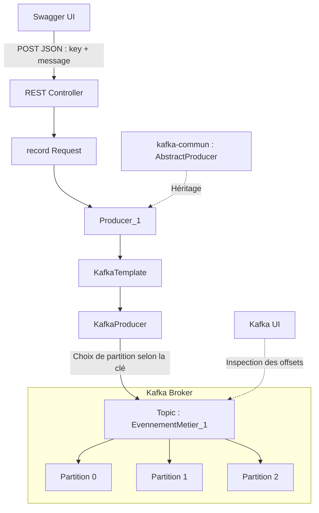

# Scénario 03 — Keys & Partitions

## Objectif

Observer comment les **clés Kafka** déterminent la répartition des événements entre les **trois partitions d'un seul topic, `EvennementMetier_1`**, et vérifier que chaque partition possède sa propre séquence d'offsets.

## Hypothèse

- À configuration de partitionnement inchangée, les messages ayant la même clé sont dirigés vers la même partition.
- Deux clés différentes peuvent aboutir à la même partition.
- Les offsets évoluent indépendamment dans chaque partition, quelle que soit la clé.

## Prérequis

- Broker Kafka et Kafka UI démarrés avec Docker Compose.
- Microservice `producer` Spring Boot opérationnel, API accessible via Swagger UI (port `8081` lors des tests).
- Bibliothèque Maven `kafka-commun` utilisée par le Producer.
- **Un seul topic : `EvennementMetier_1`**, configuré avec **3 partitions** et un facteur de réplication de **1**.
- Java 21 ; Spring Boot 4.1.1 ; connexion au broker via `localhost:6000` depuis le Producer.

### Architecture



## Configuration

### Topic

Le topic **`EvennementMetier_1`** possède trois partitions (`0`, `1`, `2`) et un facteur de réplication de `1`.

```java
@Bean
public NewTopic evenementMetierTopic() {
    return new NewTopic("EvennementMetier_1", 3, (short) 1);
}
```

### Requête HTTP

Le Controller reçoit une clé et un message sous forme d'un record Java :

```java
public record Request(String key, String message) {}
```

Exemple de JSON envoyé depuis Swagger UI :

```json
{
  "key": "2",
  "message": "Test de partitionnement"
}
```

Le Controller transmet les valeurs au service :

```java
producer.process(request.key(), request.message());
```

La bibliothèque `kafka-commun` propose la publication avec ou sans clé :

```java
public CompletableFuture<SendResult<String, T>> publish(String key, T event) {
    return kafkaTemplate.send(getTopic(), key, event);
}

public CompletableFuture<SendResult<String, T>> publish(T event) {
    return kafkaTemplate.send(getTopic(), event);
}
```

Dans `Producer_1`, `process(key, message)` attend la confirmation par `future.join()` puis journalise le topic, la partition et l'offset renvoyés par Kafka.

## Procédure

1. Démarrer Kafka et Kafka UI.
2. Démarrer le microservice Producer.
3. Ouvrir Swagger UI et publier plusieurs messages sur **`EvennementMetier_1`** avec les clés `1`, `2`, `3` et `4`.
4. Répéter les publications avec les clés `2`, `3` et `4`.
5. Relever pour chaque publication les métadonnées `topic`, `partition` et `offset` dans les logs de `Producer_1`.
6. Vérifier la répartition des messages entre les trois partitions dans Kafka UI.

## Résultats

### 1. Répartition observée

| Clé | Partition | Offsets observés |
|---|---:|---|
| `1` | `0` | `10` |
| `2` | `2` | `0`, `2`, `3`, `4` |
| `3` | `2` | `1`, `5`, `6` |
| `4` | `1` | `0`, `1`, `2` |

Une autre publication est confirmée sur la **partition 0, offset 9**, mais sa clé n'est pas visible dans l'extrait de logs fourni.

### 2. Extraits de logs

```text
key=2 → topic=EvennementMetier_1, partition=2, offset=0
key=3 → topic=EvennementMetier_1, partition=2, offset=1
key=1 → topic=EvennementMetier_1, partition=0, offset=10
key=4 → topic=EvennementMetier_1, partition=1, offset=0
key=2 → topic=EvennementMetier_1, partition=2, offset=2
key=2 → topic=EvennementMetier_1, partition=2, offset=3
key=2 → topic=EvennementMetier_1, partition=2, offset=4
key=3 → topic=EvennementMetier_1, partition=2, offset=5
key=3 → topic=EvennementMetier_1, partition=2, offset=6
key=4 → topic=EvennementMetier_1, partition=1, offset=1
key=4 → topic=EvennementMetier_1, partition=1, offset=2
```

### 3. Analyse

**Même clé, même partition :** la clé `2` est toujours dirigée vers la partition `2` pendant les tests ; la clé `4` vers la partition `1`.

**Clés différentes, même partition :** les clés `2` et `3` arrivent toutes deux en partition `2`. Leurs messages partagent la **même suite d'offsets**, par exemple `0` (clé `2`), `1` (clé `3`), puis `2` (clé `2`).

**Offsets indépendants :** les trois partitions ont leurs propres positions de fin. À l'issue des publications montrées dans l'extrait :

| Partition | Dernier offset observé | Prochain offset de cette partition, si aucune autre écriture n'intervient |
|---|---:|---:|
| `0` | `10` | `11` |
| `1` | `2` | `3` |
| `2` | `6` | `7` |

### 4. Tests complémentaires — Publication sans clé et partition imposée

#### Test 1 — Publication sans clé : validé

Plusieurs événements ont été publiés dans le topic `EvennementMetier_1` avec `key=null`.

**Résultats observés :**

| Clé | Partition | Offset |
|---|---|---|
| `null` | 2 | 8 |
| `null` | 2 | 9 |
| `null` | 2 | 10 |
| `null` | 2 | 11 |

**Observation :** les quatre événements ont été envoyés dans la partition `2`, avec des offsets consécutifs.

**Conclusion :** sans clé, Kafka sélectionne automatiquement la partition. Plusieurs messages successifs peuvent être envoyés dans la même partition (*sticky partitioning*).

#### Test 2 — Publication vers une partition imposée : à valider

Le Producer a été adapté pour permettre de sélectionner explicitement une partition avec `KafkaTemplate.send()`.

**Exemple de requête Swagger :**

```json
{
  "partition": 1,
  "key": "123",
  "message": "Message vers la partition 1"
}
```

## Conclusion

> **Hypothèse confirmée sur les messages observés.** Le topic unique `EvennementMetier_1` répartit les événements entre ses trois partitions. Une clé identique a conservé la même partition pendant les tests ; deux clés différentes (`2` et `3`) ont partagé la partition `2`. Les offsets sont attribués **par partition**, et non par clé ou globalement pour le topic.

>Cette stabilité dépend de la configuration du partitionneur et du nombre de partitions. Un changement de partitionnement peut modifier la destination de futures publications.